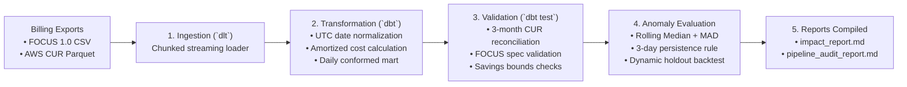

# Cloud FinOps Cost, Amortization & Anomaly Pipeline

Data pipeline that ingests cloud billing exports (FOCUS 1.0 and AWS CUR) into PostgreSQL or BigQuery, models amortized cost with dbt Core, detects spend anomalies with rolling MAD, and generates departmental savings reports.

---

## 1. Generated Reports

Dynamic reports compiled on each run of `pipeline.sh`:

* **Action Impact Report**: [analysis/reports/impact_report.md](analysis/reports/impact_report.md)  
  Department-specific action items (DevOps, Finance, Infra) with calculated dollar savings ranges for the latest run.
* **Technical Audit Report**: [analysis/reports/pipeline_audit_report.md](analysis/reports/pipeline_audit_report.md)  
  Data engineering verification: cash-to-amortized reconciliation tables, rounding variance breakdown, and out-of-sample backtest MAE results.

---

## 2. Pipeline Flow



---

## 3. How to Run

1. **Set environment variables**:
   ```bash
   cp .env.example .env
   # Set PG_HOST, PG_PORT, PG_USER, PG_PASSWORD, PG_DATABASE
   ```

2. **Execute pipeline** (runs ingestion, dbt models, tests, anomaly detection, and compiles reports):
   ```bash
   bash pipeline.sh local
   ```

3. **Inspect generated reports**:
   * Action items & savings: `analysis/reports/impact_report.md`
   * Data audit & model backtest: `analysis/reports/pipeline_audit_report.md`

---

## 4. Optimization Levers & Mechanics

The pipeline models 5 cost reduction levers against the conformed billing dataset:

| Lever | Target Spend | Method | Reference |
| :--- | :--- | :--- | :--- |
| **EC2 Savings Plan Floor Sizing** | Steady-state On-Demand compute | Sizes 1-year No-Upfront Compute SP to p10 daily usage floor | [AWS Savings Plans](https://aws.amazon.com/savingsplans/compute-pricing/) |
| **Non-Prod GPU Instance Scheduling** | Instances tagged `environment = dev` | Automated off-hours shutdown (7 PM to 7 AM + weekends) | [AWS Instance Scheduler](https://docs.aws.amazon.com/solutions/latest/instance-scheduler-on-aws/solution-overview.html) |
| **Unutilized Reserved Instance Recovery** | Empty reservation commitments | EC2 reservation modification or resale on RI Marketplace | [AWS RI Modification](https://docs.aws.amazon.com/AWSEC2/latest/UserGuide/ri-Modifying.html) |
| **S3 Internet Egress Reduction** | Public S3 GET egress traffic | CloudFront edge caching and Gzip/Brotli compression | [AWS S3 Pricing](https://aws.amazon.com/s3/pricing/) |
| **Unattached Public IPv4 Release** | VPC Elastic IPs without active attachment | Release idle IPv4 allocations via AWS CLI | [AWS IPv4 Charges](https://aws.amazon.com/blogs/aws/new-aws-public-ipv4-address-charge-public-ip-insights/) |

---

## 5. Configuration & Project Layout

* **Parameters & Assumptions**:
  * Anomaly detection & holdout ratios: `analysis/config.yaml`
  * Savings reduction factors (low / base / high): `dbt_finops/seeds/seed_finops_savings_assumptions.csv`
  * Savings Plan floor percentile: `dbt_finops/dbt_project.yml` (`vars.sp_floor_percentile: 0.10`)

* **Repository Layout**:
  ```
  ├── ingestion/           # dlt streaming loaders for FOCUS CSV and CUR Parquet
  ├── dbt_finops/          # dbt Core project
  │   ├── models/staging/  # Source views & UTC boundary enforcement
  │   ├── models/marts/    # Conformed daily cost, reconciliation, KPIs, savings
  │   ├── seeds/           # Savings reduction assumptions and AWS doc URLs
  │   └── tests/           # 28 data tests (reconciliation and spec checks)
  ├── analysis/
  │   ├── config.yaml      # Anomaly thresholds, targets, and reporting paths
  │   ├── reports/         # Generated output reports (impact & audit)
  │   └── spike_and_forecast_eval.py # Anomaly detector & report generator
  └── pipeline.sh          # Pipeline wrapper script
  ```

---

## 6. Known Limitations

- [ ] **Static Sample Data**: Data loads from public sample exports rather than an automated S3 bucket sync or EventBridge notification.
- [ ] **Billing Timezone Differences**: Oracle FOCUS records use vendor billing conventions (`billing_period_date` on first of subsequent month), handled via conditional test filters.
- [ ] **No Utilization Telemetry**: Rightsizing is modeled from billing lines; joining CloudWatch/Compute Optimizer CPU and memory telemetry is required for instance family downsizing.
